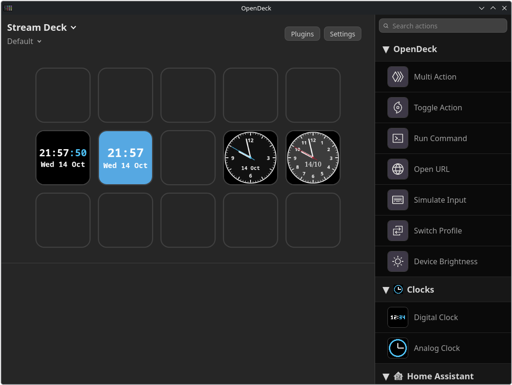

# OpenDeck Clocks

Customizable digital and analog clocks showing local time and date on a key.

Clocks adds two actions to [OpenDeck](https://github.com/nekename/OpenDeck) that turn any key into a live clock. Every key has its own settings, so you can mix and match: a big white digital clock on one key, a sweeping analog clock with a photo behind it on another.

